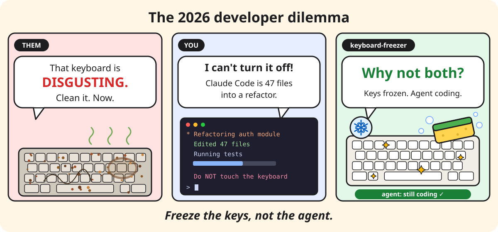

<p align="center">
  
</p>

<h1 align="center">❄️ keyboard-freezer</h1>

<p align="center">
  <b>Freeze the keys, not the agent.</b><br>
  Lock your keyboard for 5 minutes so you can clean it, while your AI agent keeps coding.
</p>

<p align="center">
  
  
  
  
</p>

---

## The problem

It's 2026. Your AI agent (Claude Code, ChatGPT, Codex, Cursor, you name it) has been refactoring your codebase for 40 minutes. It's on file 47. The tests are almost green.

Then someone who loves you (your partner, your mom, your roommate with opinions) glances at your desk and says:

> "That keyboard is disgusting. Clean it. **Now.**"

And they're right. There's a whole ecosystem in there.

But:

- 🔌 **You can't shut the computer down.** The agent is mid-task. You'd lose 40 minutes of progress and the agent's train of thought.
- 🧽 **You can't wipe it while it's on.** Every swipe of the cloth types `jjjjjjjjj;;;;;;;;;` into the agent's prompt, hits Enter, and approves something you'll regret.
- 💻 **You can't unplug it.** It's a laptop. Or it's a desktop, but the cable is behind the desk, behind the cat.

## The fix

```bash
python keyboard_freezer.py
```

<p align="center">
  
</p>

For 5 minutes, every key you press goes straight into the void. Your agent keeps working, the mouse keeps working, and nothing you scrub ends up in a prompt.

When time's up, the keyboard comes back on its own and tells you how many keys you smashed:

```text
  ✅ Keyboard is back.
  137 keys smashed! That keyboard needed it. Your AI agent saw none of them.
```

(Press nothing at all and it will ask whether you actually cleaned it. 🤨)

## Quick start

You need Python 3.9 or newer. No `pip install`, no dependencies: it's one file and only uses the standard library.

**Windows (PowerShell):**

```powershell
irm https://raw.githubusercontent.com/aamirovich/keyboard-freezer/main/keyboard_freezer.py -OutFile keyboard_freezer.py
python keyboard_freezer.py
```

Or just clone the repo. If `.py` files open with Python on your machine, double-clicking `keyboard_freezer.py` works too; the window closes by itself when the keyboard is back.

## Usage

```bash
python keyboard_freezer.py          # 5 minutes (the default)
python keyboard_freezer.py 2        # 2 minutes
python keyboard_freezer.py 0.5      # 30 seconds
python keyboard_freezer.py -s 45    # 45 seconds
```

The maximum is 60 minutes. Nobody cleans a keyboard for longer than that. We checked.

## Emergency exit

Changed your mind? Need to type something urgently? You have options:

1. **Close the terminal window with the mouse.** The keyboard unlocks instantly. This is the official panic button.
2. **Ctrl+Alt+Del** always works on Windows; Windows doesn't let any program block it. From there, open Task Manager and end `python`.
3. **The watchdog.** Even if something goes badly wrong, the program kills itself 15 seconds after the timer ends. A dead process can't hold your keyboard hostage.

## How it works

On Windows it installs a global low-level keyboard hook (`WH_KEYBOARD_LL`) and returns "handled" for every key, so the key never reaches any app. No admin rights needed. All of it is about 300 lines in [`keyboard_freezer.py`](keyboard_freezer.py), written with nothing but `ctypes`.

A few details that matter more than they sound:

- **No stuck keys.** It waits for you to let go of Enter before locking. Without that, Windows could think the key is still held down after the freeze.
- **The unlock never depends on the UI.** The deadline lives in the main loop, printing can't crash it, and the watchdog backs it all up.
- **It counts, it doesn't log.** Key codes are only used to tell a press from a release. Nothing is stored, written to disk, or sent anywhere.

## Platform support

| Platform | Status |
| --- | --- |
| Windows 10 / 11 | ✅ Works. Tested on Windows 11 with injected keys: blocked during the freeze, delivered after. |
| macOS | 🚧 Not yet |
| Linux | 🚧 Not yet |

## FAQ

**Is this a keylogger?**
No. It never records which keys you press, only how many, so it can roast you at the end. It's one short file; read it, it takes two minutes.

**Why isn't there an `.exe`?**
A tiny unsigned program that hooks your keyboard looks exactly like malware to every antivirus on earth. A Python file you can read is more trustworthy than a binary you can't.

**Will it stop my AI agent?**
No. It only eats keyboard input. Every program keeps running, including the agent, its terminal, and your music.

**My laptop's brightness and volume keys still work during the freeze.**
Some laptops handle `Fn` key combos in firmware, before the operating system sees them. Nothing a normal program can do about that. Wipe gently.

**My cat walks on my keyboard. Can I use this?**
Absolutely. This is also a cat tool. 🐈

## License

[MIT](LICENSE). Clean responsibly.
